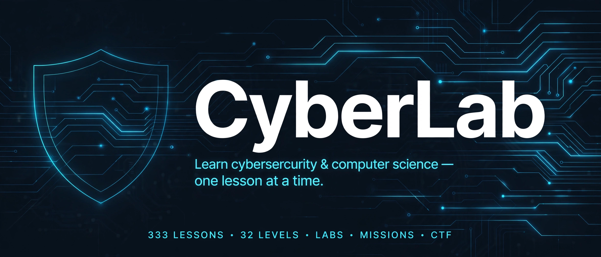

# CyberLab

[](https://cyberlab27.pages.dev)
[](LICENSE)

An interactive cybersecurity and computer science learning environment — **333 lessons, 32 levels, labs, missions and CTF challenges.**

**[Try the live app →](https://cyberlab27.pages.dev)**

---

## What is CyberLab?

CyberLab is a complete full-stack web application: a progressive web app (PWA) frontend hosted on Cloudflare Pages, a Cloudflare Workers API for accounts and progress sync, and a Cloudflare D1 database. This repository contains everything needed to run and deploy it — clone it, install, build, and deploy (see [SETUP.md](SETUP.md)).

## Features

- **333 Learning Lessons** — textbook-style lessons (topic → main point → definitions → worked example → exercises), each with a six-part "why" explanation panel
- **32 Progressive Levels** — Levels 0–31, from orientation and diagnostics through hacking tracks to CSE gap subjects (Data Structures, DBMS, Theory of Computation, Compiler Design, AI/ML basics)
- **Interactive Practical Labs** — hands-on labs with a live try-area beside the instructions; code genuinely runs (JavaScript and Python in the browser, other languages through a remote runner)
- **Security Missions and CTF Challenges** — case-file missions with hands-on practicals, and Capture The Flag challenges whose flags are validated server-side
- **Accounts & Progress Sync** — sign up / sign in, PBKDF2-hashed passwords, session tokens, XP, streaks and progress saved per account on any device
- **Password Reset by Email** — 6-digit code flow via the Brevo API (code stored only as a hash, 15-minute expiry, single use)
- **Six Languages** — English, Bangla, Spanish, German, Chinese and Hindi from a single language dropdown
- **PWA** — installable, standalone, with an offline app shell

## How it works

1. **Learn** — open a lesson and read it like a textbook chapter, with a live terminal / code playground beside the content.
2. **Practice** — do the lab, mission or terminal exercise for that lesson.
3. **Prove it** — pass the lesson quiz (≥ 70%) and the practical to complete the lesson. Lessons unlock strictly in order — opening or scrolling a lesson gives no completion or XP.
4. **Advance** — a checkpoint follows every 3–4 lessons; each level ends with a Level Final (quiz + practical/mission + short written task). Passing it unlocks the next level.
5. **Exception** — Level 4 Lesson 1 is a second open entry point; its final unlocks Level 5 onward.

---

## Technology Stack

- **JavaScript**
- **Cloudflare Workers** — the API backend (`cloudflare/worker.js`)
- **Cloudflare D1** — the SQL database (8 tables, `cloudflare/schema.sql`)
- Frontend: a React single-page application (TypeScript source, bundled with Bun + Tailwind CSS) hosted on Cloudflare Pages

## Architecture

```
┌────────────────────────────┐      HTTPS       ┌──────────────────────────┐      Binding "DB"      ┌─────────────────────┐
│  Cloudflare Pages          │ ───────────────▶ │  Cloudflare Worker       │ ─────────────────────▶ │  Cloudflare D1      │
│  PWA frontend (this repo's │  /auth/*         │  "cyberlab"              │  prepared statements   │  "cyberlab-db"      │
│  client/, built bundle)    │  /progress       │  cloudflare/worker.js    │                        │  8 tables           │
└────────────────────────────┘                  └──────────────────────────┘                        └─────────────────────┘
                                                           │
                                                           │  BREVO_API_KEY (Worker secret)
                                                           ▼
                                                  Brevo email API
                                                  (password-reset codes)
```

- **Pages frontend** — serves the app shell, lessons and playgrounds. All lesson content is in the bundle; the app also works offline from the PWA cache and keeps local progress in the browser.
- **Worker API** — handles sign up, sign in, sessions, progress load/save and password reset. Passwords are hashed with PBKDF2-HMAC-SHA256 (100,000 iterations, per-user salt); only SHA-256 hashes of session tokens and reset codes are stored. CORS is a strict allowlist of the production Pages domains — never a wildcard.
- **D1 database** — `users`, `sessions`, `login_failures`, `progress_items`, `quiz_attempts`, `research_notes`, `password_resets`, `user_state`. Every query is scoped by the `user_id` taken from the session, never from the request body.

## Project Structure

```
cyberlab/
├── README.md               ← this file
├── SETUP.md                ← full setup & deploy guide, step by step
├── .env.example            ← env variable names with empty placeholders
│                             (the real .env is never committed — see SETUP.md)
├── assets/
│   └── banner.png          ← README hero banner
├── package.json            ← scripts: typecheck / build / build:pages
├── client/
│   ├── index.html          ← app entry page
│   ├── build.mjs           ← production build (bundle + stamped service worker)
│   ├── public/             ← PWA manifest, icons, service worker source, og-image.png (link preview)
│   └── src/                ← the full application source (lessons, labs,
│                             missions, CTF, terminal, playgrounds, i18n)
├── cloudflare/
│   ├── worker.js           ← the Worker API (auth, progress, password reset)
│   ├── schema.sql          ← D1 schema — all 8 tables
│   ├── wrangler.toml       ← Worker config (name "cyberlab", DB binding)
│   └── _headers            ← Pages security + PWA cache headers
├── server/                 ← reference implementation of the optional
│                             enrichment actions (CISA KEV / EPSS Threat Intel)
├── scripts/
│   └── make-pages.mjs      ← assembles the Pages deploy folder (pages-dist/)
└── vendor/space-sdk/       ← minimal local shim of the Muse platform SDK
                              surface the client imports, so the repo builds
                              standalone (see vendor/space-sdk/README.md)
```

## Getting Started

Full step-by-step instructions are in **[SETUP.md](SETUP.md)**. The short version:

```bash
git clone https://github.com/hossainabirdev/cyberlab.git
cd cyberlab
bun install
bun run typecheck     # TypeScript check — client + server
bun run build:pages   # builds the app and assembles pages-dist/
```

Then deploy in this order (each step is explained in SETUP.md):

1. **D1** — create the database and run `cloudflare/schema.sql`
2. **Worker** — deploy `cloudflare/worker.js`, bind it to D1 as `DB`, and set the `BREVO_API_KEY` secret
3. **Pages** — upload the contents of `pages-dist/`

> **No secrets live in this repository.** The Brevo API key is set only as a Cloudflare Worker secret (`BREVO_API_KEY`); the repo ships `.env.example` with variable names and empty placeholders only — there is no real `.env` file, no user data, and no build output in the repo.

## Development Approach

I build with an **AI-assisted development workflow**: I lead the planning, feature design, implementation, integration, testing and iteration, using AI tools to move faster — and I build by understanding the architecture and the code underneath, not by copying output I cannot explain. CyberLab was developed this way end to end: curriculum design, gating/unlock logic, the Worker API, the D1 schema, the CORS allowlist and the password-reset flow were each designed, tested against the live deployment, and iterated on step by step.

## Skills

| Skill | Level / Proof |
| --- | --- |
| JavaScript | Practical — the CyberLab Worker API and the in-browser code playgrounds |
| HTML & CSS | Practical — CyberLab's complete responsive UI and PWA shell |
| Git & GitHub | **Confident** — Branching, Merging, Rebase, Stash |
| Python | Working knowledge — lesson code, log-parsing and security exercises |
| Supabase | Practical — realtime backend in my other web projects |
| Cloudflare Workers & D1 | Practical — the CyberLab backend (auth, progress sync, password reset) |
| SQL | Working knowledge — designed CyberLab's 8-table D1 schema |
| C | Academic — Structured Programming coursework and CyberLab's C track |
| Cybersecurity | Focus area — designed CyberLab's labs, missions and CTF challenges |
| AI-Assisted Development | Workflow — see Development Approach above |
| Godot | Learning — game development |

## Research Interests

Exploratory interests I am building towards:

- Intrusion Detection Systems (IDS)
- Industrial Control Systems (ICS) Security
- Industrial Network Security
- SWaT Dataset
- AI/ML Applications in Cybersecurity

## About Me

**Md Abir Hossain** — Aspiring Software Engineer.

My primary focus is **Software Engineering**. My additional strengths and interests include AI, Cybersecurity, Cloud, and Creative Production.

### Education

| Qualification | Institution | Year |
| --- | --- | --- |
| BSc in Computer Science & Engineering | Uttara University, Dhaka, Bangladesh | 2026 – Present |
| HSC | B.A.F. Shaheen College, Kurmitola | 2025 |
| SSC | B H Khan School and College | 2023 |

### English Proficiency

- **PTE Academic — Overall Score: 65** (2026)

## Contact

- **Email:** hossainabirdev@gmail.com
- **GitHub:** [github.com/hossainabirdev](https://github.com/hossainabirdev)
- **LinkedIn:** [linkedin.com/in/abir-hossain-dev](https://www.linkedin.com/in/abir-hossain-dev)
- **Portfolio:** [WebByAbir](https://webbyabir.pages.dev)

## License

This project is licensed under the MIT License — see the LICENSE file.
